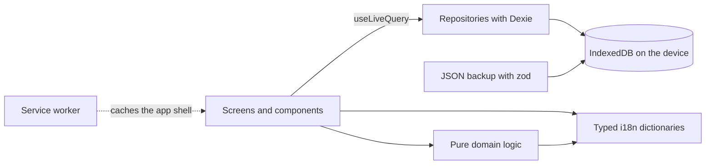

<p align="center">
  
</p>

<h1 align="center">Headly</h1>

<p align="center">
  A calm, minimal migraine tracker that lives entirely on your phone.<br />
  No account. No server. No tracking.
</p>

---

## What it does

Headly records a few facts about each migraine and turns them into trends you can bring to your doctor.

- **Track an attack in one tap.** Start it, update the pain level (0–10) while it lasts, end it.
- **Log medication** in one tap and rate later whether it helped.
- **Calendar** with every day at a glance, and details and editing for each day.
- **Statistics** from one week to all your data: migraine days and medication days per period, average pain, how well each medication works, and a warning when medication use gets close to overuse.
- **Insights in plain language**, such as "Migraine days dropped from 6 to 4 per month", each with an arrow that shows whether the change is good and an info button that explains how it was calculated.
- **Preventions** (medication or lifestyle) with a before/after comparison and a small chart per prevention. You can set when a prevention is expected to start working.
- **Life events** like a new job or stopping the pill, with the same before/after view.
- **PDF report for the doctor**: a plain, printable table with one row per day for the last 3 or 6 months, plus a monthly overview.
- **Backup**: JSON export and import, and a gentle reminder to back up.
- **German and English**, switchable at any time.
- **Installable and offline**: add it to the iPhone home screen and it opens full-screen and works without a network.

## The thinking behind it

**Made for the moment you feel worst.** Headly has to work during an acute migraine. That's why it uses low contrast, big touch targets (at least 48 px, primary actions 64 px), one or two taps per action and no decorative animation.

**Not a diary.** Every extra field is a reason not to log. Headly asks for as little as possible and does the thinking afterwards.

**Your health data stays yours.** All entries live in the browser's IndexedDB on your device. Nothing is sent anywhere, and there is no analytics and no third-party request at runtime. Fonts and icons are bundled. The trade-off is that you are responsible for backups, so the app reminds you.

**Answers doctors actually ask for.** How many migraine days per month? How many medication days? Which prevention, and did it help? Statistics, insights and the PDF are built around those questions, not around everything that could be measured.

**Honest numbers.** Comparisons are always shown per 30 days so periods of different length can be compared. They say which windows they compare and when there is too little data to mean much. Preventions take their delayed effect into account, because many take 2–3 months to work.

## Architecture



The app is a static single-page app. There is no backend; the only server is a static host that delivers the files once.

| Layer  | Folder                          | What lives there                                                                                                                                                  |
| ------ | ------------------------------- | ----------------------------------------------------------------------------------------------------------------------------------------------------------------- |
| Domain | `src/domain`                    | Pure functions for everything that counts: migraine days, statistics, chart buckets, prevention effects, insights. No React, no database, fully unit tested.      |
| Data   | `src/data`                      | Dexie database with versioned schema migrations, one repository per entity, and backup export/import validated with zod.                                          |
| i18n   | `src/i18n`                      | Typed dictionaries. `en.ts` is the source of truth, so a missing German key is a compile error. Insights are templates per language, never translated at runtime. |
| UI     | `src/components`, `src/screens` | React components with CSS Modules and design tokens. Four tabs: Home, Calendar, Statistics, Profile.                                                              |

**Key decisions**

- **Dexie over raw IndexedDB or localStorage.** It gives typed tables, indexed queries, schema migrations and live queries, so the UI updates on its own when data changes.
- **Hand-rolled SVG charts** instead of a chart library. They're small and fast, and only the visible page plus its neighbours are drawn, so years of data stay smooth.
- **Printing instead of a PDF library.** The report is a print stylesheet; the browser's print menu turns it into a PDF.
- **No notifications.** iOS can only wake a web app through a push server, and that would break the "no server" promise.

## Tech stack

React 18 · TypeScript (strict) · Vite · vite-plugin-pwa · Dexie · zod · date-fns · React Router · CSS Modules · Vitest · Testing Library

## Getting started

```bash
npm install
npm run dev        # dev server
npm test           # unit and component tests
npm run build      # typecheck and production build
```

Also available: `npm run typecheck`, `npm run lint` and `npm run format`.

## Sample data

`sample-data/headly-sample-backup.json` holds about 1.5 months of example entries (mid-September to early November 2026). Import it under **Profile → Import data** to try Headly without your own data.

## Deployment

Every push to `main` is built and deployed by Cloudflare as static files (`npm run build`, output `dist`). The page is marked `noindex`, so it stays out of search engines.

## Disclaimer

Headly is not a medical device and does not replace medical advice.
